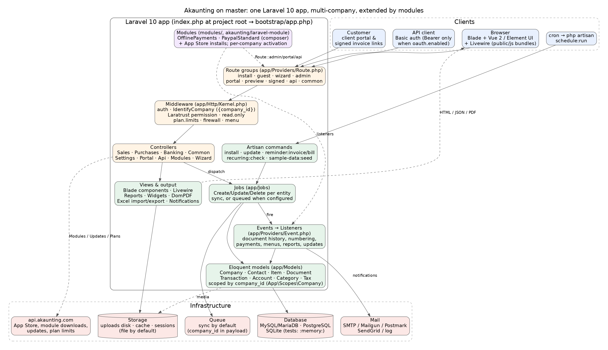

# Akaunting architecture

What the code on `master` does today. The diagram source is
[`diagrams/architecture.dot`](diagrams/architecture.dot); re-render it with
[`diagrams/render.sh`](diagrams/render.sh) (needs Graphviz) after changing it.

## Shape of the system

Akaunting is a single Laravel 10 application (PHP 8.1 to 8.3). One codebase serves the
admin panel, the customer portal, signed public links, the installer and a REST
API. Every business record belongs to a company, and several companies can live
in one database. Optional features ship as modules.

| Layer | Where | What it does |
| --- | --- | --- |
| Entry point | `index.php` (project root), `bootstrap/app.php` | The web server's document root is the project root. `server.php` lets `php artisan serve` resolve the `/public/...` asset URLs. |
| Routing | `app/Providers/Route.php`, `routes/*.php` | Maps the route groups below and adds the `Route::admin/portal/preview/signed/api` macros that modules use. |
| Middleware | `app/Http/Kernel.php`, `app/Http/Middleware` | One middleware group per route group: auth, company identification, Laratrust permissions, read-only mode, plan limits, firewall, menus. |
| Controllers | `app/Http/Controllers/<Area>` | Thin: validate with a Form Request, dispatch a job, return a view or JSON. API controllers live under `Api/`. |
| Jobs | `app/Jobs/<Area>` | All writes (`CreateDocument`, `UpdateTransaction`, `CreateCompany`, ...). Run sync, or queued when `QUEUE_CONNECTION` is not `sync`. |
| Events and listeners | `app/Events`, `app/Listeners`, `app/Providers/Event.php` | Side effects: document history, next-number counters, payment transactions, notifications, menu building, report filters, version upgrade steps. |
| Models | `app/Models/{Auth,Banking,Common,Document,Module,Setting}` | Eloquent models; `App\Scopes\Company` adds `company_id = company_id()` to company-owned queries. |
| Presentation | `resources/views`, `app/View/Components`, `resources/assets/js` | Blade components plus Vue 2 / Element UI page bundles built by Laravel Mix into `public/js` and `public/css`; Livewire for menus and notifications. |
| Reports and widgets | `app/Reports`, `app/Widgets`, `app/Abstracts/Report.php` | Profit and loss, income/expense, tax and discount summaries; dashboard widgets. Listeners in `app/Listeners/Report` add filters and grouping. |
| Console | `app/Console/Commands`, `app/Console/Kernel.php` | `install`, `update`, `sample-data:seed`, and the daily schedule: invoice/bill reminders, `recurring:check`, temp storage cleanup, model pruning. |
| Modules | `modules/`, `config/module.php`, `app/Utilities/ModuleActivator.php` | Packages loaded with `akaunting/laravel-module`. `OfflinePayments` and `PaypalStandard` are installed by Composer; others come from the App Store. Activation is stored per company. |

## Route groups

Mapped in this order by `App\Providers\Route::map()`:

| Group | Prefix | Used for |
| --- | --- | --- |
| `install` | `/install` | Web installer (requirements, language, database, admin user). |
| `api` | `/api` (`API_PREFIX`) | REST API for users, companies, items, contacts, documents, transactions, accounts, settings. |
| `common` | `/{company_id}` | Admin dashboard, portal dashboard, uploads, wizard entry, Livewire updates. |
| `guest` | `/auth` | Login, forgot/reset password, invitation registration. |
| `wizard` | `/{company_id}/wizard` | First-run company setup wizard. |
| `admin` | `/{company_id}` | The admin panel: sales, purchases, banking, reports, settings, apps. |
| `preview` | `/{company_id}/preview` | Admin preview of the customer view of a document. |
| `portal` | `/{company_id}/portal` | Customer portal: invoices, payments, profile. |
| `signed` | `/{company_id}/signed` | Public signed links to an invoice or payment (no login). |
| `web` | `/` | Only the Livewire script route. |

## Multi-company tenancy

`IdentifyCompany` reads the company id from the `{company_id}` route segment
(or the query string or a header; for API calls with a Bearer token, the token's
company wins), checks the
user may access that company (or that the URL is signed), calls
`$company->makeCurrent()`, registers that company's enabled modules and sets URL
defaults so generated routes keep the prefix. Models then filter by
`company_id()` through `App\Scopes\Company`. Queued jobs carry `company_id` in
their payload and restore the company before running (`App\Providers\Queue`).

## Core domain

* **Documents** (`App\Models\Document\Document`): invoices and bills, plus their
  recurring templates, with items, item taxes, totals and a history trail. The
  `type` column (`invoice`, `bill`, `invoice-recurring`, `bill-recurring`)
  selects the behaviour; `config/type.php` holds per-type settings.
* **Transactions** (`App\Models\Banking\Transaction`): income and expense,
  including transfer, split and recurring variants, against an `Account`.
  `Transfer` pairs two transactions; `Reconciliation` marks them as matched to a
  bank statement.
* **Contacts**: customers, vendors and employees. **Items**: products and services
  with taxes. **Categories**, **Currencies**, **Taxes** and **Settings**
  (`akaunting/laravel-setting`, stored per company) configure the rest.
* **Users** have roles and permissions through Laratrust and can belong to
  several companies.

## A write request, end to end

Creating an invoice (`POST /{company_id}/sales/invoices`):

1. The `admin` middleware group authenticates the user, identifies the company,
   checks the `create-sales-invoices` permission and blocks the write in
   read-only mode.
2. `Sales\Invoices@store` validates with `App\Http\Requests\Document\Document`
   and calls `ajaxDispatch(new CreateDocument($request))`.
3. `CreateDocument` saves the document, items, taxes and totals in a transaction
   and fires `DocumentCreated`.
4. `CreateDocumentCreatedHistory` records history and
   `IncreaseNextDocumentNumber` bumps the invoice number setting.
5. The controller returns JSON with a redirect, which the Vue page follows.

## External services

* **Database**: MySQL/MariaDB, PostgreSQL or SQLite (`config/database.php`). Tests
  use SQLite `:memory:` from `.env.testing`.
* **Storage**: the `uploads` disk by default (`plank/laravel-mediable` for
  attachments); S3 is available through Flysystem.
* **Mail**: SMTP, Mailgun, Postmark, SendGrid or the log driver.
* **api.akaunting.com** (`App\Traits\SiteApi`): App Store listings, module
  downloads, core updates and plan limits.
* **Error reporting**: Sentry and Bugsnag clients are installed and read their
  settings from the environment.

## Build and test

* PHP dependencies: `composer install`. Front-end assets: `npm install` then
  `npm run dev` or `npm run production` (Node 18 or 20).
* Tests: `cp .env.testing .env`, build the assets, then `php artisan test
  --parallel`. CI (`.github/workflows/tests.yml`) runs this on PHP 8.1, 8.2 and
  8.3.
